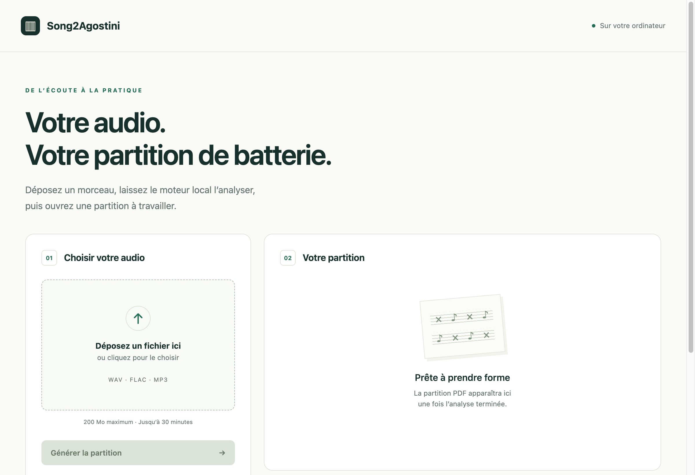

# Song2Agostini

**Un morceau → une partition de batterie.** Choisissez un fichier WAV, FLAC ou MP3, lancez la transcription, puis consultez et téléchargez le PDF, le MusicXML éditable et le MIDI.

La fenêtre de l’application utilise votre ordinateur pour isoler la batterie et préparer une écriture française inspirée d’Agostini : cymbales au-dessus, grosse caisse et caisse claire dans une seconde voix, regroupement des notes par temps. Aucun audio n’est envoyé à un service externe.

La partition reste un **brouillon à relire par un musicien**. La reconnaissance des instruments, les premiers temps et les rythmes complexes peuvent encore comporter des erreurs. Le projet n’est pas affilié aux éditions Agostini.

## Installer et ouvrir

Suivez [INSTALL.md](INSTALL.md). L’installation depuis les sources utilise Python 3.11 et des environnements séparés. FFmpeg et MuseScore sont nécessaires pour produire les partitions PDF.

Vous pouvez aussi donner le lien de ce dépôt à votre agent avec cette consigne :

> Installe Song2Agostini en suivant INSTALL.md. Utilise des environnements isolés, vérifie les outils et ouvre la fenêtre native. N’envoie aucun audio à un service externe. Signale clairement les étapes impossibles sur cet ordinateur.

Les paquets autonomes Windows et Mac sont en préparation ; aucun téléchargement stable n’est proposé pour le moment. Les vérifications Windows 10/11 restent à réaliser sur ces systèmes.

## Pour contribuer

[État actuel](STATUS.md) · [Installation technique](docs/installation-technique.md) · [Compatibilité des plateformes](docs/platform-support.md) · [Licences des composants](THIRD_PARTY_NOTICES.md).

L’application se trouve dans `src/drum_lab/`. Les expériences et les outils de comparaison sont documentés dans [lab/](lab/README.md). Les partitions de référence restent réservées au vérificateur : elles ne sont jamais fournies au moteur qui génère la partition.

Le code propre à ce projet est sous licence MIT. Les moteurs, modèles et outils tiers conservent leurs licences distinctes. Les enregistrements, références, poids et résultats locaux ne sont pas inclus dans le dépôt.
